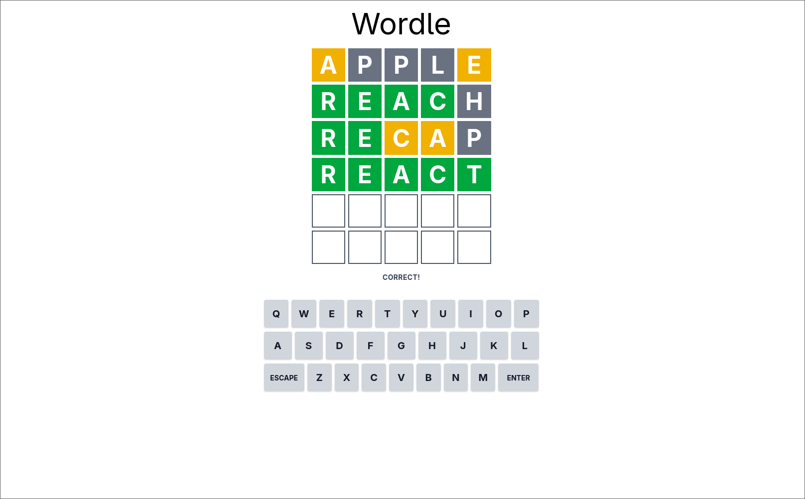
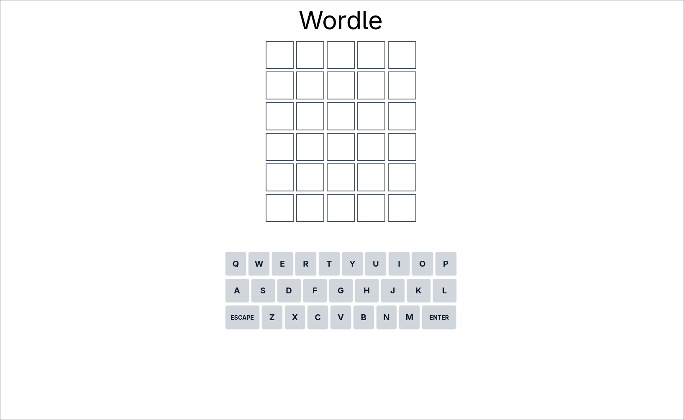
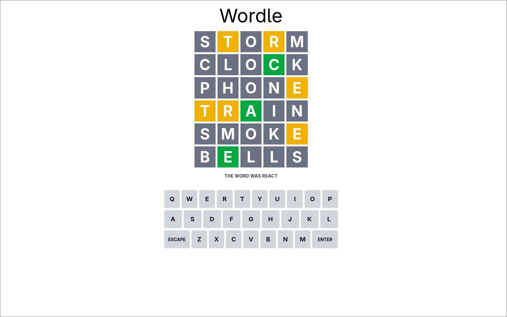

<div align="center">



# Wordle

**Przeglądarkowa gra w odgadywanie słów stworzona w React i TypeScript**

[](https://wordle-kappa-plum.vercel.app/)
[](https://github.com/a-jadczak/wordle/commits)
[](https://github.com/a-jadczak/wordle)
[](https://github.com/a-jadczak/wordle)

</div>

## 📋 Spis treści

- [🎯 Opis](#-opis)
- [✨ Funkcje](#-funkcje)
- [🚀 Demonstracja](#-demonstracja)
- [🖼️ Zrzuty ekranu](#️-zrzuty-ekranu)
- [🛠️ Technologie](#️-technologie)
- [🏁 Pierwsze kroki](#-pierwsze-kroki)
- [📖 Obsługa](#-obsługa)
- [🧪 Testowanie](#-testowanie)
- [📁 Struktura projektu](#-struktura-projektu)
- [📄 Licencja](#-licencja)

## 🎯 Opis

### **Wordle to jednostronicowa aplikacja internetowa, w której gracz ma sześć prób na odgadnięcie pięcioliterowego słowa.**

Gra ma jedno stałe hasło i po każdej próbie oznacza litery kolorami. Projekt powstał, aby przećwiczyć tworzenie komponentów w React, zarządzanie stanem i implementację logiki gry.

## ✨ Funkcje

### Plansza na sześć prób

Wpisz pięć liter w aktywnym wierszu. Zatwierdzone próby pozostają widoczne, dzięki czemu możesz wrócić do wcześniejszych wskazówek.

### Klawiatura ekranowa

Wybieraj litery na klawiaturze ekranowej. Przycisk **ESCAPE** usuwa ostatnią literę, a **ENTER** zatwierdza próbę.

### Kolorowe wskazówki

Zielony oznacza literę na właściwej pozycji, żółty literę na innej pozycji, a szary literę, dla której nie ma już dopasowania w haśle.

### Komunikaty o wygranej i przegranej

Poprawna odpowiedź kończy rundę komunikatem o wygranej. Po sześciu nieudanych próbach gra ujawnia hasło.

## 🚀 Demonstracja

W grę można zagrać w przeglądarce.

### **[→ Otwórz wersję demonstracyjną](https://wordle-kappa-plum.vercel.app/)**

> Gra nie wymaga instalacji ani zakładania konta.

## 🖼️ Zrzuty ekranu

<p align="center">
  
</p>

<p align="center">
  
</p>

<p align="center">
  
</p>

## 🛠️ Technologie

| Kategoria     | Technologie                             |
| ------------- | --------------------------------------- |
| **Frontend**  | `React` · `TypeScript` · `Tailwind CSS` |
| **Testy**     | `Vitest`                                |
| **Narzędzia** | `Vite` · `ESLint`                       |

## 🏁 Pierwsze kroki

### 📋 Wymagania

| Wymaganie | Wersja                          |
| --------- | ------------------------------- |
| Node.js   | `22.13+` z linii 22.x lub `24+` |
| npm       | Instalowany razem z Node.js     |

### 📦 Instalacja

**1. Sklonuj repozytorium**

```bash
git clone https://github.com/a-jadczak/wordle.git
```

**2. Przejdź do katalogu projektu**

```bash
cd wordle
```

**3. Zainstaluj zależności**

```bash
npm install
```

### 💻 Praca nad aplikacją

Uruchom serwer deweloperski Vite.

```bash
npm run dev
```

Następnie otwórz w przeglądarce adres [http://localhost:5173](http://localhost:5173).

### 🏭 Kompilacja produkcyjna

Zbuduj zoptymalizowaną wersję produkcyjną.

```bash
npm run build
```

Pliki wynikowe znajdziesz w katalogu `dist/`. Poniższe polecenie uruchamia lokalny podgląd.

```bash
npm run preview
```

## 📖 Obsługa

1. Wybierz pięć liter za pomocą klawiatury ekranowej.
2. Użyj przycisku **ESCAPE**, jeśli chcesz usunąć ostatnią literę.
3. Wybierz **ENTER**, aby zatwierdzić próbę. Wpisanie mniej niż pięciu liter nie zużywa próby.
4. Wykorzystaj zielone, żółte i szare pola jako wskazówki przy kolejnej próbie.
5. Graj, aż odgadniesz hasło lub wykorzystasz wszystkie sześć prób.

## 🧪 Testowanie

| Polecenie            | Działanie                                  |
| -------------------- | ------------------------------------------ |
| `npm test`           | Uruchamia testy Vitest jednokrotnie        |
| `npm run test:watch` | Ponawia testy Vitest po zmianach w plikach |

## 📁 Struktura projektu

```text
wordle/
├── .github/
│   ├── assets/                 # Zrzuty ekranu do portfolio i README
│   └── portfolio.yaml
├── src/
│   ├── components/             # Plansza, pola i klawiatura ekranowa
│   ├── config/                 # Długość hasła i limit prób
│   ├── constants/              # Układ klawiatury
│   ├── context/                # Stan gry i ocena prób
│   ├── test/                   # Konfiguracja środowiska testowego
│   ├── App.test.tsx             # Testy interakcji w grze
│   ├── App.tsx                  # Układ aplikacji
│   ├── main.tsx                 # Punkt wejścia aplikacji
│   └── style.css                # Punkt wejścia dla stylów Tailwind CSS
├── index.html                   # Plik wejściowy HTML dla Vite
├── package.json
└── vite.config.ts               # Konfiguracja Vite i Vitest
```

## 📄 Licencja

Projekt jest udostępniany na [licencji MIT](../../LICENSE).

<div align="center">

**[⬆ Wróć na początek](#wordle)**

</div>
