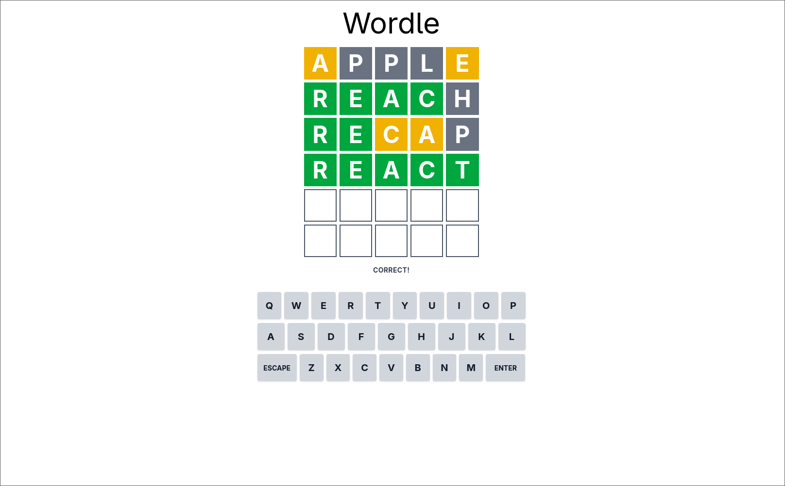
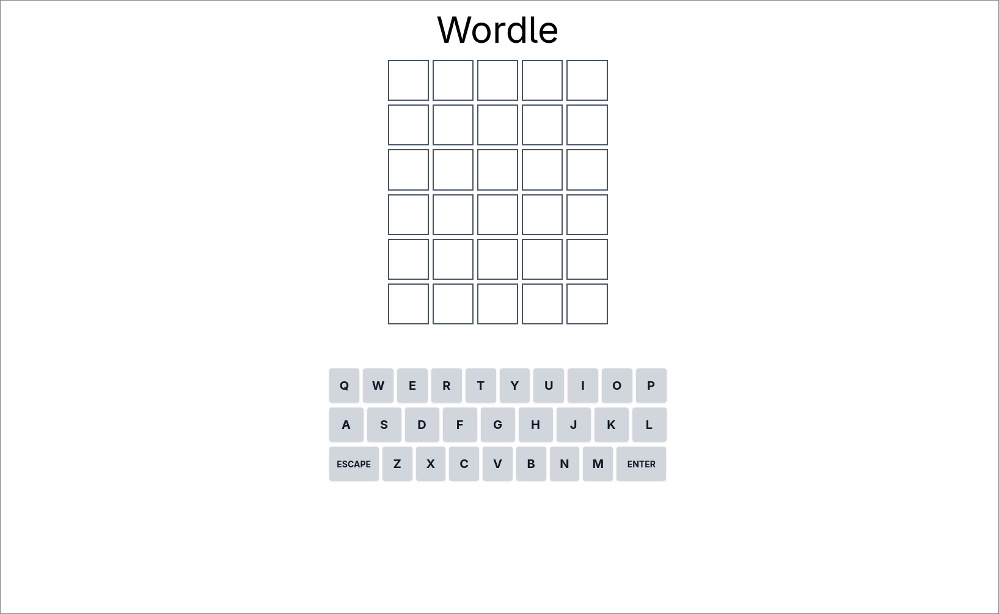
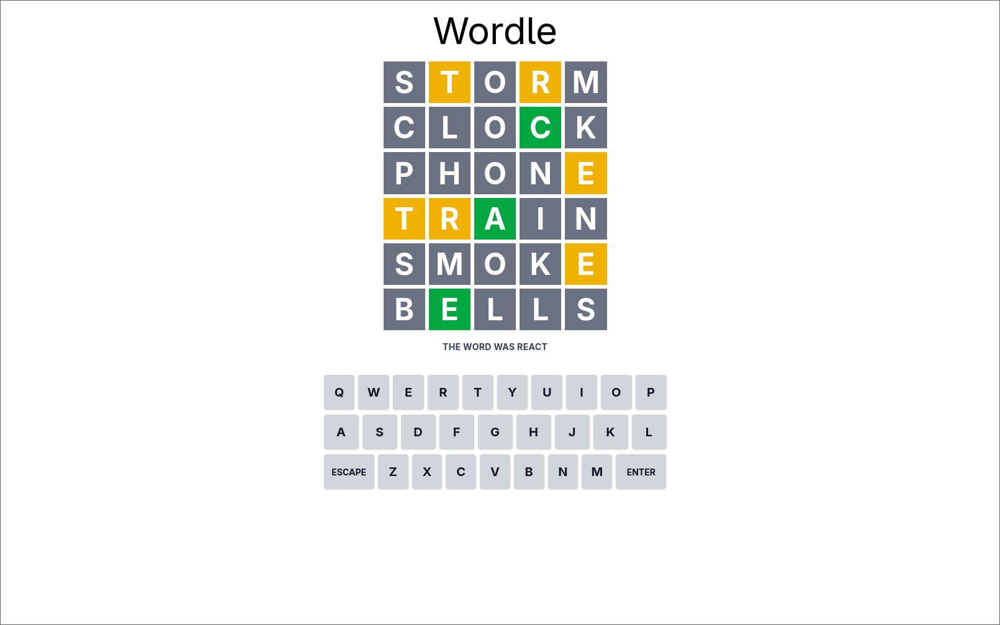

<div align="center">



# Wordle

**A browser-based word guessing game built with React and TypeScript**

[](https://wordle-kappa-plum.vercel.app/)
[](https://github.com/a-jadczak/wordle/commits)
[](https://github.com/a-jadczak/wordle)
[](https://github.com/a-jadczak/wordle)

</div>

## 📋 Table of Contents

- [🎯 Overview](#-overview)
- [✨ Features](#-features)
- [🚀 Demo](#-demo)
- [🖼️ Screenshots](#️-screenshots)
- [🛠️ Tech Stack](#️-tech-stack)
- [🏁 Getting Started](#-getting-started)
- [📖 Usage](#-usage)
- [🧪 Testing](#-testing)
- [📁 Project Structure](#-project-structure)
- [📄 License](#-license)

## 🎯 Overview

### **Wordle is a single-page web application where players have six attempts to guess a five-letter word.**

The game uses a fixed answer and scores each guess with color-coded tiles. The project was built to practice React component architecture, state management, and game logic.

## ✨ Features

### Six-attempt board

Enter a five-letter guess in the active row. Each submitted guess stays visible, so you can refer to earlier clues.

### On-screen keyboard

Select letters to fill the active row, use **ESCAPE** to delete the last letter, and select **ENTER** to submit.

### Color-coded feedback

Green marks a letter in the correct position, yellow marks a letter in a different position, and gray marks a letter with no remaining match.

### Win and loss messages

A correct guess ends the round with a success message. After six unsuccessful guesses, the game reveals the answer.

## 🚀 Demo

The application is available online.

### **[→ Open Live Demo](https://wordle-kappa-plum.vercel.app/)**

> No installation or account is required to play.

## 🖼️ Screenshots

<p align="center">
  
</p>

<p align="center">
  
</p>

<p align="center">
  
</p>

## 🛠️ Tech Stack

| Category     | Technologies                            |
| ------------ | --------------------------------------- |
| **Frontend** | `React` · `TypeScript` · `Tailwind CSS` |
| **Testing**  | `Vitest`                                |
| **Tooling**  | `Vite` · `ESLint`                       |

## 🏁 Getting Started

### 📋 Requirements

| Requirement | Version                             |
| ----------- | ----------------------------------- |
| Node.js     | `22.13+` on the 22.x line, or `24+` |
| npm         | Included with Node.js               |

### 📦 Installation

**1. Clone the repository**

```bash
git clone https://github.com/a-jadczak/wordle.git
```

**2. Enter the project directory**

```bash
cd wordle
```

**3. Install dependencies**

```bash
npm install
```

### 💻 Development

Start the Vite development server.

```bash
npm run dev
```

Then open [http://localhost:5173](http://localhost:5173).

### 🏭 Production Build

Create an optimized production build.

```bash
npm run build
```

The output is written to `dist/`. Preview it locally with the following command.

```bash
npm run preview
```

## 📖 Usage

1. Select five letters using the on-screen keyboard.
2. Select **ESCAPE** to remove the last letter if needed.
3. Select **ENTER** to submit the guess. A guess with fewer than five letters leaves the current attempt available.
4. Use the green, yellow, and gray tiles to guide the next guess.
5. Keep guessing until you find the answer or use all six attempts.

## 🧪 Testing

| Command              | Purpose                   |
| -------------------- | ------------------------- |
| `npm test`           | Run the Vitest suite once |
| `npm run test:watch` | Run Vitest in watch mode  |

## 📁 Project Structure

```text
wordle/
├── .github/
│   ├── assets/                 # Portfolio and README screenshots
│   └── portfolio.yaml
├── src/
│   ├── components/             # Board, tiles, and on-screen keyboard
│   ├── config/                 # Word length and attempt limit
│   ├── constants/              # Keyboard layout
│   ├── context/                # Game state and guess scoring
│   ├── test/                   # Test setup
│   ├── App.test.tsx             # Game interaction tests
│   ├── App.tsx                  # Game layout
│   ├── main.tsx                 # Application entry point
│   └── style.css                # Tailwind CSS entry point
├── index.html                   # Vite HTML entry point
├── package.json
└── vite.config.ts               # Vite and Vitest configuration
```

## 📄 License

This project is licensed under the [MIT License](./LICENSE).

<div align="center">

**[⬆ Back to top](#wordle)**

</div>
